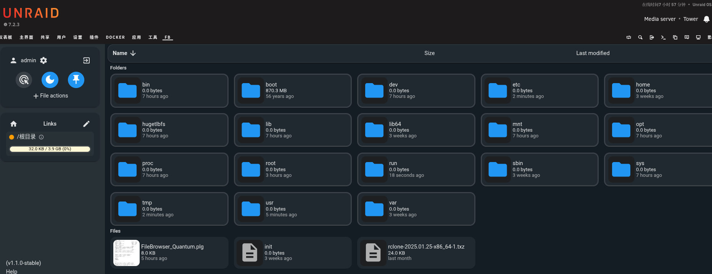
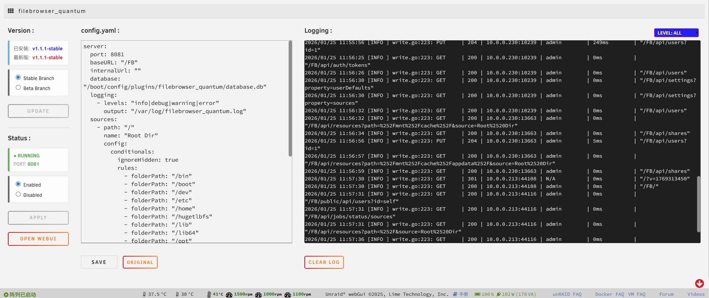

# FileBrowser Quantum for Unraid

<p align="center">
  
</p>

<p align="center">
  <a href="README_CN.md">中文</a> | English
</p>

<p align="center">
  
  
</p>

---

## Introduction

**FileBrowser Quantum** is a high-performance file manager plugin designed specifically for Unraid, built on the [FileBrowser Quantum](https://github.com/gtsteffaniak/filebrowser) project (the actively maintained fork of the original FileBrowser) v2 core.

> This repository is a fork of [insomnia417/Unraid-FileBrowser_Quantum-Plugins](https://github.com/insomnia417/Unraid-FileBrowser_Quantum-Plugins). On top of the original author's work, it adapts the plugin to FileBrowser Quantum v2 and adds the internal/external URL split, among other improvements. Many thanks to the original author, insomnia417.

### Features

- **Quantum v2 core**: SQLite database, indexed search, image/video/office previews, share links, WebDAV, multi-source management, API tokens, and more — see the [upstream docs](https://filebrowserquantum.com/en/docs/)
- **Internal/External URL split**: the FQ tab automatically picks the right FileBrowser address based on how you reach the Unraid WebUI — works behind a reverse proxy
- **GUI management**: edit `config.yaml` visually from the settings page, with real binary pre-save validation
- **One-click updates**: check and install new upstream releases from the plugin page, with stable / beta branch switching
- **Live log**: view the service log from the settings page without a terminal

---

## Installation

Install manually via URL in **Plugins** -> **Install Plugin**:

```
https://raw.githubusercontent.com/simon2137/Unraid-FileBrowser-Quantum-V2/main/FileBrowser_Quantum.plg
```

Open unRAID WebUI, go to the "Plugins" tab, click "Install Plugin", and enter the following URL in the input box:

---

## First Login

| Scenario | How to log in |
|---|---|
| **Fresh install** | Username `admin`; the password is a **randomly generated initial password** that is logged once on first startup — see "Finding the initial password" below |
| **Upgrading from v1** | Existing accounts and passwords are preserved by the database migration — log in with your previous password |

**Forgot the password / can't find the initial password?** Run on the Unraid terminal:

```bash
filebrowser_quantum user set admin --password 'your-new-password' --admin
```

**Finding the initial password** (after a fresh install, on the first startup):

```bash
grep -i "password" /var/log/filebrowser_quantum.log | head -5
```

> Note: the live-log window on the settings page only shows the last 50 lines. For startup-time messages, check the full log file from a terminal.

---

## Internal/External URL Split (Reverse Proxy)

The FQ tab picks the FileBrowser URL automatically based on how you access the Unraid WebUI. Configure both under the `http:` node of `config.yaml`:

```yaml
http:
  port: 8081
  baseURL: "/"
  # Internal URL used when accessing via LAN IP; empty = auto http://<host>:<port>
  internalUrl: ""
  # External URL used when accessing via domain, e.g. https://filebrowser.example.com:8888
  externalUrl: ""
```

| How you access Unraid | The FQ tab loads |
|---|---|
| LAN IP, e.g. `http://192.168.1.10/` | `internalUrl` (empty = `http://192.168.1.10:8081`) |
| Domain, e.g. `https://nas.example.com/` | `externalUrl` |

- `externalUrl` must be **HTTPS** (when the parent page is https, browsers block http iframes as mixed content)
- Detection rule: the access host is treated as LAN if it is a private range (127/10/172.16-31/192.168/169.254, localhost); everything else uses `externalUrl`. If `externalUrl` is not set, it always falls back to internal behavior

### Reverse Proxy Requirements for FileBrowser

The reverse proxy behind `externalUrl` (upstream `http://<NAS_IP>:8081`) needs:

```nginx
location / {
    proxy_pass http://192.168.1.10:8081;
    proxy_http_version 1.1;
    proxy_set_header Host $host;
    proxy_set_header X-Forwarded-For $proxy_add_x_forwarded_for;
    proxy_set_header X-Forwarded-Proto $scheme;
    proxy_set_header Upgrade $http_upgrade;
    proxy_set_header Connection "upgrade";
    proxy_buffering off;        # Quantum real-time features use SSE; buffering must be off
    client_max_body_size 0;     # unlimited upload size
}
```

- **Nginx Proxy Manager**: enable **Websockets Support** to cover the upgrade headers
- **Lucky**: make sure WebSocket/SSE passthrough is enabled
- Sanity check: open `externalUrl` directly in a browser — you should see the FileBrowser login page

---

## Upgrading from v1 (Automatic Migration)

Installing (or updating to) the v2 version of this plugin runs a fully automatic upgrade:

1. **Config conversion**: a v1 `config.yaml` is converted to the v2 structure, **preserving port, `internalUrl` and `externalUrl`**; the old file is backed up as `config.yaml.v1.bak`
2. **Database migration**: the legacy BoltDB (`database.db`) is renamed to `database.db.old`; on first start v2 automatically imports **users, passwords, share links and API tokens** into SQLite (`filebrowser.sqlite`) via `migrateFrom`, then the one-shot migration key is removed automatically
3. **Cache cleanup**: v1 binary caches are discarded and the v2 binary is downloaded fresh

After upgrading, note:

- **Permission model change**: v2 replaces v1's global modify/download permissions with per-directory (scope) authorization. Review each user's directory permissions in the FileBrowser settings page after migrating
- Back up the database before upgrading: `cp /boot/config/plugins/filebrowser_quantum/database.db ~/database.db.backup`
- To roll back a failed migration: reinstall the old plugin version, rename `database.db.old` back to `database.db`, and restore `config.yaml` from `config.yaml.v1.bak`

---

## config.yaml Reference (v2)

```yaml
http:
  port: 8081
  baseURL: "/"
  internalUrl: ""            # internal URL for the FQ tab
  externalUrl: ""            # external (reverse-proxied) URL for the FQ tab
  trustProxyHeaders: false   # recommended true when behind a reverse proxy
server:
  database:
    path: "/boot/config/plugins/filebrowser_quantum/filebrowser.sqlite"
  logging:
    - levels: "info|debug|warning|error"
      output: "/var/log/filebrowser_quantum.log"
  sources:
    - path: "/"
      name: "Root Dir"
      config:
        rules:               # index exclusion rules (hides system directories)
          - folderPath: "/proc"
          - folderPath: "/sys"
          - folderPath: "/dev"
auth:
  methods:
    password:
      enabled: true
```

Full field reference: [upstream configuration docs](https://filebrowserquantum.com/en/docs/configuration/).

---

## FAQ

**The FQ tab is blank / spins forever?**
Press F12 and inspect the iframe's `src`: when accessing by domain it should be your `externalUrl`. If it shows `https://domain:internal-port`, `externalUrl` is not configured; if the browser reports mixed content, `externalUrl` is http.

**"Wrong password" on login?**
First make sure you haven't triggered brute-force protection (repeated failures temporarily ban the IP — wait 10 minutes). If it still fails, reset the password using the command in "First Login".

**Startup/migration messages missing from the live log?**
The log window only shows the last 50 lines. The full log is at `/var/log/filebrowser_quantum.log` — use `grep` from a terminal.

**Plugin file changes lost after reboot?**
`/usr/local/emhttp` lives in RAM — this is normal. The plugin package is re-applied at boot. To customize plugin files yourself, edit the txz under `/boot/config/plugins/filebrowser_quantum/install/` on the flash drive, or apply patches at boot with the User Scripts plugin.

---


## THANKS

Original Project: [FileBrowser Quantum](https://github.com/gtsteffaniak/filebrowser)

Original plugin: [insomnia417/Unraid-FileBrowser_Quantum-Plugins](https://github.com/insomnia417/Unraid-FileBrowser_Quantum-Plugins)

